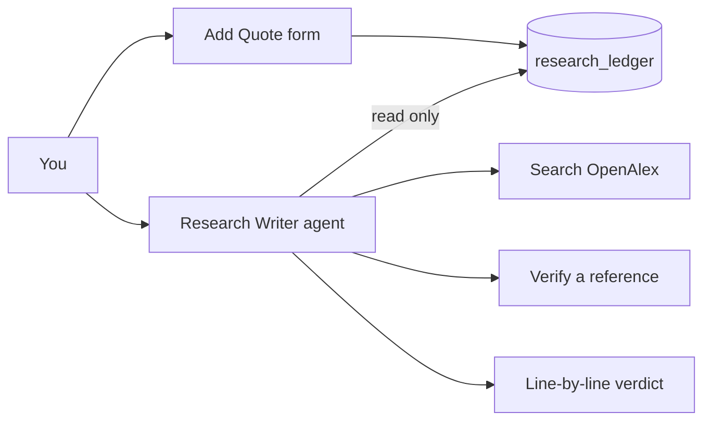

# [AI Agent] Research Writer

**Type:** AI agent

One n8n Agent that helps a researcher check a draft against a quote ledger, verify references, find papers and polish their own sentences. It never writes content for them and never invents a reference.

**Status (2026-10-30):** unpublished draft in n8n, not finished. Results are in [eval.md](eval.md).

## How it works

- **Quote ledger:** the n8n data table `research_ledger`. Only a person can add to it, through the Add Quote form (`add-quote-helper.json`). The agent can only read it.
- **Tools (`tools-helper.json`):** read the ledger, search OpenAlex, verify a reference. Answers come from the database or ledger, not the AI.
- **Model:** Groq `openai/gpt-oss-20b`, free tier, 200,000 tokens a day shared across Groq steps.

## Limitations
- Check about 10 sentences at a time. A 30-sentence check timed out.
- The sample ledger holds only 8 quotes from abstracts.

## Rebuild it
An n8n Agent is not a workflow, so there is no `workflow.json`. These files replace it.
1. Create a data table named `research_ledger` with the text columns `source_title`, `authors`, `doi`, `quote`, `page`, `note` and a number column `year`.
2. Import `tools-helper.json` and `add-quote-helper.json`, then publish both.
3. Create an n8n Agent from `agent-config.json`, and select your own Groq credential.
4. Add the quotes from `sample-input/sample-ledger.json`, then paste 10 sentences at a time from `sample-input/seeded-draft.txt`.

Real output is in `sample-output/`. This rebuild has not been tested on a fresh n8n.

## Screenshots
- [The agent page](screenshots/agent-page-full.jpg): model, full instructions and tools.
- [The tools helper canvas](screenshots/tools-helper-canvas.jpg)
- [The Add Quote helper canvas](screenshots/add-quote-helper-canvas.jpg)

The page shows the agent as an unpublished draft, which it is.
