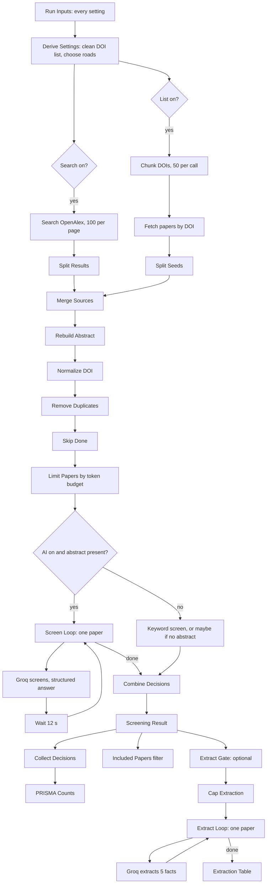
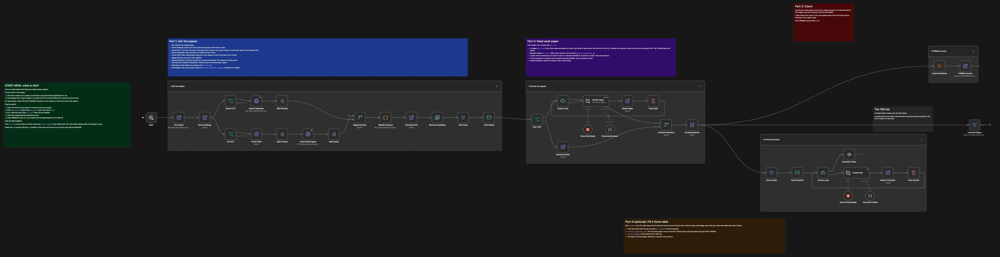
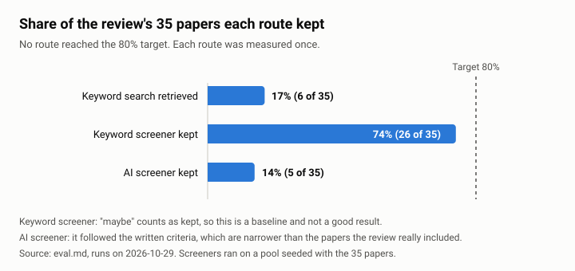

# [Workflow] Research and Conference Hunter

**Type:** Workflow

An n8n workflow that helps a researcher run the **screening stage of a systematic literature review (SLR)**. It either searches for papers on a topic or takes a list the researcher already has, removes duplicates, screens every paper against written inclusion and exclusion criteria with a stated reason, counts the papers for a PRISMA flow diagram, and can fill a small facts table per paper. A token budget keeps AI cost under control. A human checks every result.

**Status (2026-10-29):** the paper-side workflow is built, tested and exported (`workflow.json`). Not built: the Zotero push and the conference call-for-papers branch, even though the project name mentions conferences. See [Status and roadmap](#status-and-roadmap).

Reading order for an AI agent or a reviewer: this file, then [PORTFOLIO_BRIEF.md](PORTFOLIO_BRIEF.md) (verified facts and safe claims), then [eval.md](eval.md) (measurements).

## The problem
Screening is the slowest, most repetitive step of an SLR. A researcher reads hundreds of titles and abstracts and decides include or exclude against written criteria, and must be able to report how many papers were found, removed and kept (PRISMA). People differ in how they apply the criteria, and AI tools that screen papers can waste money on tokens or quietly invent facts.

## What it does
1. **Gets papers** in one of three ways (`mode` in the Run Inputs node):
   - `search`: no papers yet. Searches the OpenAlex scholarly database for a topic.
   - `my_papers`: the researcher already has a sorted list of DOIs. Fetches exactly those papers, no search.
   - `both`: the list first, then search results.
2. **Cleans** the pool: rebuilds abstracts (OpenAlex ships them as a word-position index), normalises DOIs, removes duplicates.
3. **Caps** the pool by a token budget, so AI cost is known before the run.
4. **Screens** each paper: `include`, `exclude` or `maybe`, with a one-sentence reason and the criterion that decided it. Two screeners: an AI screener (Groq) or a free keyword screener.
5. **Counts** the results for PRISMA, and reports how many of the researcher's own papers were found and kept.
6. **Optionally extracts facts** per paper (study type, technology, participants, outcomes, main finding) from the abstract, capped by its own token budget.

Design rules: one paper per AI call with no memory, so papers cannot influence each other; the AI reads title and abstract only (no full text); a missing fact is written `not stated`, never guessed; papers with no abstract are not sent to the AI and become `maybe` for a human; an unreadable AI answer becomes `maybe` or `extraction failed`, not a crashed run; a person reviews the result before anything is saved elsewhere.

## Architecture

The workflow has a manual trigger only (it is not published or scheduled). The canvas carries plain-language sticky notes explaining each part.

## Canvas
The whole workflow with every group opened. Open the stage images to read it at full size.

1. [Start and inputs](screenshots/canvas-1-start-and-inputs.jpg)
2. [Get the papers](screenshots/canvas-2-get-the-papers.jpg)
3. [Screen the papers](screenshots/canvas-3-screen-the-papers.jpg)
4. [Extract the facts](screenshots/canvas-4-extract-the-facts.jpg)
5. [Count and the YES list](screenshots/canvas-5-count-and-yes-list.jpg)

## Node groups (45 nodes including 6 sticky notes)
| Group | Nodes | Job |
|---|---|---|
| 1 Get the papers | Run Inputs, Derive Settings, Search On?, List On?, Search OpenAlex, Split Results, Chunk DOIs, Split Chunks, Fetch Seed Papers, Split Seeds, Merge Sources, Rebuild Abstract, Normalize DOI, Remove Duplicates, Skip Done, Limit Papers | Choose road(s), fetch, clean, dedupe, skip already-done papers, cap by token budget. |
| 2 Screen the papers | Use LLM?, Screen Loop, Screen Paper, Groq Chat Model, Screening Decision, Attach Paper, Pace Calls, Keyword Screen, Combine Decisions, Screening Result | AI or keyword screening; one decision row per paper. |
| 3 PRISMA counts | Collect Decisions, PRISMA Counts | One row of counts. |
| 4 Extract the facts | Extract Gate, Cap Extraction, Extract Loop, Extract Info, Groq Extract Model, Extraction Fields, Attach Extraction, Pace Extract, Extraction Table | Optional facts table. |
| (output) | Included Papers | Filter that keeps only `include`. |

n8n node types used: Manual Trigger, Edit Fields (Set), IF, HTTP Request (pagination, retry), Split Out, Merge, Code (one node, the abstract rebuild, with a stated reason), Remove Duplicates, Filter, Limit, Loop Over Items, Wait, Basic LLM Chain with Groq Chat Model and Structured Output Parser, Aggregate, No Operation, Sticky Note. Only one Code node; everything else is native.

## Run Inputs reference
| Field | Default in `workflow.json` | Meaning |
|---|---|---|
| `mode` | `both` | `search`, `my_papers` or `both`. |
| `search_query` | `mixed reality personal assistant social isolation` | Search text for OpenAlex. Ignored in `my_papers`. |
| `from_year` | 2015 | Earliest publication year to search. |
| `max_pages` | 1 | OpenAlex pages of 100 papers to fetch. |
| `my_dois` | 5 sample DOIs | Your own list. Any mix of new lines, commas, spaces or `\|`, with or without `https://doi.org/`. Long lists are chunked by 50. |
| `max_papers` | 10 | Hard cap on papers screened per run. |
| `skip_first` | 0 | Continue a long list: set to the number already screened. |
| `use_llm` | `false` | `true` = Groq AI screener (needs a Groq credential). `false` = free keyword screener, no key. |
| `research_question`, `inclusion_criteria`, `exclusion_criteria` | the ICWIHI 2025 SLR's | What the AI screens against. Replace with your own. Unused by the keyword screener. |
| `keywords_a`, `keywords_b` | MR/AR terms; assistant/companion/agent/avatar terms | Keyword screener: `include` if both lists match, `maybe` if one matches, else `exclude`. Regex alternatives separated by `\|`. |
| `max_abstract_chars` | 1000 | Abstract is cut to this length before going to the AI. |
| `token_budget`, `tokens_per_paper` | 100000, 1100 | Paper cap = `min(max_papers, token_budget / tokens_per_paper)`. Papers over the cap are counted in `not_screened_over_budget`. |
| `extract` | `false` | Turn on step 4. |
| `extract_scope` | `my_list` | `my_list` = every paper from `my_dois`. Anything else = papers the screener kept (include or maybe). |
| `extract_budget`, `tokens_per_extraction` | 30000, 1250 | Extraction cap = `extract_budget / tokens_per_extraction` papers (24 by default). |

`sample-input/run-inputs.quickstart.json` holds the shipped defaults. `sample-input/run-inputs.slr-icwihi-2025.json` holds the settings used for the evaluation (full criteria, 35 DOIs).

## Outputs
| Output | Where | Fields |
|---|---|---|
| PRISMA counts | node `PRISMA Counts` | `identified`, `duplicates_removed`, `not_screened_over_budget`, `screened`, `included`, `maybe`, `excluded`, `sent_to_ai`, `est_tokens_used`, `my_list_requested`, `my_list_found_in_openalex`, `my_list_kept`, `my_list_rejected`, `my_list_kept_percent`, `other_papers_rejected_percent` |
| Decision per paper | node `Screening Result` | `doi_norm`, `title`, `publication_year`, `decision`, `reason`, `criterion`, `in_my_list`, `engine` (`ai` or `keyword`) |
| YES list | node `Included Papers` | rows with `decision = include` |
| Facts table | node `Extraction Table` | `doi_norm`, `title`, `decision`, `study_type`, `technology`, `participants`, `outcomes`, `main_finding` |

Real examples are in `sample-output/`.

## Token and cost control
- AI calls use Groq `openai/gpt-oss-120b`, temperature 0, one paper per call, paced 12 seconds apart (the Groq free tier allows 8,000 tokens per minute).
- Measured: screening 1,065 tokens per paper (9 calls, 9,582 tokens: about 914 prompt, 172 answer). Extraction 1,237 tokens per paper (10 calls, 12,374 tokens).
- Controls: `max_abstract_chars`, `token_budget`, `max_papers`, `skip_first`, no AI for papers without an abstract, `use_llm` false for a zero-token run, separate `extract_budget`.
- Money: OpenAlex needs no key for basic use and bills list calls at about $0.10 per 1,000 and search calls at about $1 per 1,000 against a free daily budget (about $0.10 per day without a key, $1 with a free account). One search page is therefore about $0.001. Groq was used on its free tier, so AI cost was $0 but rate-limited. Paid Groq pricing was not measured.
- Time: about 12 seconds per AI-screened paper, so 100 papers take about 20 minutes. Free keyword screening takes seconds.

## Results in one table
Full detail and caveats in [eval.md](eval.md). All runs on one local n8n 2.45.6 instance, 2026-10-29.

| Test | Result |
|---|---|
| Can keyword search find the author's 35 SLR papers? | No. 6 of 35 (17%) with the SLR's own search terms. One-hop citation chasing found about 1 of the other 30. |
| Seeded-pool test, keyword screener | 35 known papers mixed into 300 search results: 26 of 35 kept (74%), 65% of the other papers rejected. |
| Seeded-pool test, Groq AI screener, written criteria | 50 papers screened: 5 of 35 kept (14%), 100% of 15 other papers rejected. The AI applied the written criteria faithfully; 30 of the 35 papers do not match them. |
| `search`, `my_papers` and `both` modes | All three ran to success. |
| Fresh import of `workflow.json`, no credentials | Ran to success with the quickstart settings. |
| Extraction on 10 papers | 9 clean rows, 1 flagged for hand-filling. |

The 80% recall target set at the start was **not met** and was replaced by the seeded-pool test, because searching cannot reach it. This is reported as found, not hidden.

## Results at a glance

The numbers and their caveats are in [eval.md](eval.md).

## How to run it
Requirements: n8n (tested on 2.45.6, self-hosted in Docker). No other software.
1. In n8n choose **Import from file** and select `workflow.json`.
2. Click **Execute workflow**. The shipped settings need no API key: they screen 5 sample DOIs plus one search page with the keyword screener.
3. Open `PRISMA Counts`, `Screening Result` and `Included Papers` to see the result. Expect about 100 papers identified and 10 screened; search results drift over time.
4. To use the AI screener, create a Groq credential in n8n yourself (n8n Credentials screen; free key at console.groq.com), select it in `Groq Chat Model` and `Groq Extract Model`, then set `use_llm` to `true` in Run Inputs. Never paste keys into the repo.
5. For your own review, edit Run Inputs: `mode`, `my_dois` or `search_query`, and your criteria.

Credentials needed (names only): `Groq account` (type `groqApi`), only when `use_llm` or `extract` is true. OpenAlex runs keyless.

## Limitations (stated plainly)
- Screens on title and abstract only, never full text. Some papers have no abstract in OpenAlex; they become `maybe`.
- One query and one run per measurement; numbers can move with query and criteria wording.
- "Other papers rejected" is a rough noise measure. The unrelated papers were not labelled by a human.
- A recall score from criteria rewritten to fit the same 35 papers would be a ceiling, not an independent result. That rewrite and rerun was offered and has not been run.
- Groq free tier: 8,000 tokens per minute; the daily cap was not verified. The two Groq Llama models tried were enterprise-only for this account.
- Extraction facts come from abstracts only and need human checking.
- `my_dois` is fetched through OpenAlex, so a paper OpenAlex does not index is reported as not found.
- No error-handling workflow, no scheduling, manual trigger only.

## Status and roadmap
Built and tested: both input modes, dedupe, caps, AI and keyword screening, PRISMA counts, extraction, sanitized export, fresh-import test.
Not built: Zotero push with a human approval step (needs an account decision), the conference call-for-papers branch, parser auto-fix, a drawn diagram image.
Design decision: no vector database; it would be added only if `eval.md` showed it improves recall.

## Files in this folder
| File | What it is |
|---|---|
| `workflow.json` | The n8n export with credentials, IDs and personal data removed. |
| `PORTFOLIO_BRIEF.md` | Verified facts, allowed and forbidden claims, suggested page structure for whoever writes the portfolio page. |
| `eval.md` | Method and measured results with caveats. |
| `sample-input/` | `run-inputs.quickstart.json`, `run-inputs.slr-icwihi-2025.json` |
| `sample-output/` | Real PRISMA counts (3 runs and the fresh-import run), a screening result sample, an extraction table (JSON and CSV). Titles and DOIs only, no abstracts or PDFs. |
