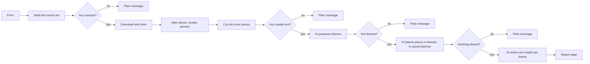
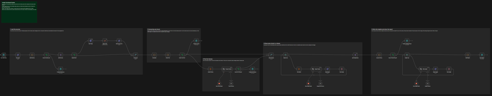

# [Workflow] Insight Synthesis Engine

**Type:** Workflow

An n8n workflow that turns mixed research material into themes and insights. A researcher pastes interview transcripts, blog posts, notes and web links into a one-page form. The workflow hides the names they list, sorts the text into themes, writes one insight per theme and shows a report with the exact quotes behind each insight. The researcher checks every insight before using it.

**Status (2026-10-30):** built, published on the author's local n8n, and tested on small synthetic samples. It has not been tested at scale or on real interview data. See [Limitations](#limitations).

Reading order for an AI agent or a reviewer: this file, then [PORTFOLIO_BRIEF.md](PORTFOLIO_BRIEF.md) (verified facts and safe claims), then [eval.md](eval.md) (tests and results).

## The problem
Qualitative synthesis is slow. A researcher has transcripts in one place, blogs and reports in another, and must read everything, group what recurs and keep track of where each point came from. General AI chat tools can summarise, but they tend to reword quotes, lose track of sources and receive participant names unless someone removes them first.

## How to use it
1. Open the form: `http://localhost:5678/form/insight-engine`.
2. Type your research question. It is the only required field.
3. Fill in what you have:
   - **Interview transcripts:** paste them. Put a line with `---` between two transcripts.
   - **Other text:** blogs, notes, reports. Use `---` the same way.
   - **Web links:** one link per line.
   - **Names to hide:** participant names, separated by commas.
4. Press **Analyse** and stay on the page. The sample took about 4 to 5 minutes.
5. Read the report, then check each insight against its quotes.

Nobody needs to open a node or edit JSON to run it.

## What it does

| Stage | What happens | AI used? |
|---|---|---|
| 1 Load the sources | Each pasted block and link becomes one source with an automatic id: `T1` transcript, `N1` other text, `W1` web page. Links are downloaded and reduced to paragraph text. | No |
| 2 Anonymise and chunk | Listed names, emails and phone numbers are replaced with `[participant]`, `[email]`, `[phone]`. Text is cut into pieces of about 180 characters, taken in turn from each source so that no source dominates. | No |
| 3 Find the themes | One AI call reads up to 30 pieces and proposes up to 5 themes. | Yes |
| 4 Place pieces in themes | Pieces go to the AI 8 at a time, with a 25-second pause between calls. A piece that fits no theme stays out of the themes, and the report counts it. | Yes |
| 5 Insights and report | One AI call per theme returns an insight, a limit and piece ids. The report is built from those. | Yes |

Design rules:
- **Quotes are never reworded.** The AI returns piece ids only. Code copies the quote text from the researcher's own material, and drops any id that does not belong to the theme.
- **Names are hidden before any AI call.** The AI never receives the raw text.
- **Every stage ends in a check.** A failed check stops the run with a plain message on the form page.
- **A single-source theme is flagged.** A theme backed by one type of source is marked for review.
- **A human checks every insight.** The report says so at the top.

## Output
The form page shows the report. The same run produces:

| Field | Meaning |
|---|---|
| `summary` | Counts: sources, pieces, placed pieces, AI batches, failed batches, themes, hidden details, AI calls, estimated tokens. |
| `warnings` | Failed links, skipped lines, failed AI batches, and how many pieces were left out by the budget. |
| `themes` | Each theme with its insight, limit, source mix, quotes and flags. |
| `miro_cards` | One card per theme for Miro or FigJam, as JSON. |
| `report_html` | The report page. All source text is escaped. |

Real examples are in [sample-output/](sample-output/). All interview and note text there is made up. The page screenshots are [form-page.jpg](sample-output/form-page.jpg) and [report-page.jpg](sample-output/report-page.jpg).

## Canvas
The whole workflow, left to right. Open the stage images to read it at full size.

1. [Start and load the sources](screenshots/canvas-1-start-and-load-sources.jpg)
2. [Anonymise, chunk and find the themes](screenshots/canvas-2-anonymise-and-find-themes.jpg)
3. [Place every chunk in a theme](screenshots/canvas-3-place-chunks-in-themes.jpg)
4. [Write the insights and show the report](screenshots/canvas-4-write-insights-and-report.jpg)

## Set it up
Needs n8n 2.45.6 or later and a Groq account. The free tier was enough for the tests.
1. Import `workflow.json` into n8n.
2. Create a Groq credential in n8n, then select it in the three nodes `Groq Theme Model`, `Groq Assign Model` and `Groq Insight Model`.
3. Publish the workflow.
4. Open `http://<your-n8n-host>/form/insight-engine`.

To try the sample, paste the files from [sample-input/](sample-input/) into the matching form fields. Credentials are the only edit. A fresh import of this `workflow.json` was tested this way (see `eval.md`).

## Settings
Normal use needs no settings. Advanced limits live in the `Run Inputs` node.

| Setting | Default | Meaning |
|---|---|---|
| `max_chunk_chars` | 180 | Target size of one text piece. |
| `max_chunks` | 40 | Most pieces analysed in a run. |
| `max_themes` | 5 | Most themes proposed. |
| `token_budget` | 20000 | Token budget used to cap the pieces. |
| `tokens_per_chunk` | 500 | Planning cost per piece. The cap is `min(max_chunks, token_budget / tokens_per_chunk)`. |
| `pace_seconds` | 25 | Pause between AI calls. |

## Cost
Measured on the sample: 14,228 to 15,980 tokens for 40 pieces, 10 or 11 AI calls, about 4 to 5 minutes. The model is Groq `openai/gpt-oss-120b` on the free tier, which is rate limited. Paid costs were not measured.

## Limitations
- **Small tests only.** It ran on small synthetic samples. Real interview data and large volumes are untested.
- **Results vary between runs.** On nearly the same sample, 14 to 29 of 40 pieces were placed, with 4 or 5 themes. Treat the output as a first draft.
- **No accuracy figure.** Output was not compared with human coding, and nothing here shows that the themes are correct.
- **At most 40 pieces per run by default.** The rest are skipped, and the report says how many. A long source can be cut short.
- **Hiding is list-based.** Only listed names, emails and common phone formats are hidden. Other identifying details stay in the text, so read transcripts first.
- **Anonymised text goes to Groq.** Check the consent terms of each study before using real transcripts.
- **The form has no login.** Anyone who can reach the n8n address can use it and spend the Groq allowance. Add a login before exposing it beyond a trusted machine.
- **Web pages need plain HTML.** Pages rendered by JavaScript may yield no text. Web quotes can carry page artefacts.
- **No file upload.** Text must be pasted, so PDFs and Word files need copying first.
- **Runs show as waiting if the page is closed.** A run stays in the Waiting state until the report page is opened.

## Status and roadmap
Done: form, anonymisation, themes, placement, insights, report page, stress tests, sanitised export, canvas screenshots.
Next, only if real use needs it: a test on one anonymised real transcript against the author's own coding, file upload, a form login, and an unknown-name check.
